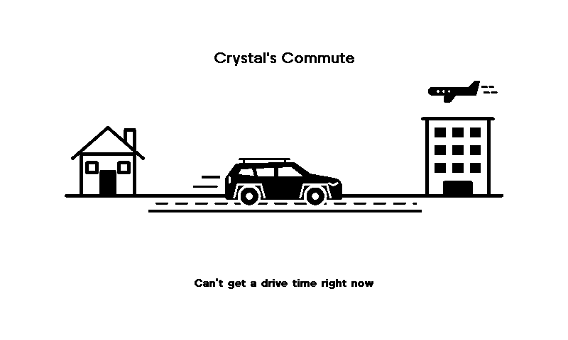

# Crystal's Commute

A TRMNL plugin that shows the live drive time from home (Burnaby) to Boeing (Richmond) using the [TomTom Routing API](https://developer.tomtom.com/routing-api/documentation), drawn as a little scene: home, a road with a 2025 Hyundai Tucson, and the office with a plane overhead.

## Demo



## How It Works

### Polling
`src/settings.yml` polls TomTom's `calculateRoute` endpoint every 15 minutes with `traffic=true&departAt=now&computeTravelTimeFor=all&routeRepresentation=summaryOnly`, so the response is just the route summary: live travel time, the historic travel time for this time of day, and the distance. The origin and destination are hardcoded coordinates.

The TomTom key is a TRMNL [Custom Field](https://help.usetrmnl.com/en/articles/10513740) (`tomtom_api_key`), interpolated into the polling URL. It is never committed.

### Transform
`src/transform.py` turns the summary into display values:
- `eta_min`, plus `leave_at` (now) and `arrive_at` (now + ETA), in America/Vancouver time
- `typical_min`, from TomTom's historic travel time
- `status` and `traffic_note`: light (<10% over usual) reads "Traffic is normal"; moderate (<30%) and heavy read "Heavy traffic, 8 min slower than usual"
- `error`, when TomTom returns no route

### Templates
`src/shared.liquid` defines `commute_scene`, an inline SVG that carries the leave, ETA and arrive numbers, and `commute_footer`, the one-line traffic note. All four layouts render the scene under a centered "Crystal's Commute" title; **quadrant** is the primary one.

## Local Development

**Lint:**
```bash
./bin/trmnlp lint
```

**Preview:** put a key in `.trmnlp.yml` (`custom_fields: { tomtom_api_key: "..." }`), **revert it to `{}` before committing**, then:
```bash
./bin/trmnlp serve
```
and open http://localhost:4567/quadrant. trmnlp polls once at startup, so restart it to fetch fresh traffic.

## Deployment

- **Lint on PR:** GitHub Actions lints the plugin on every pull request
- **Push on merge:** Merging to `main` auto-pushes to the TRMNL account via the `TRMNL_API_KEY` secret
- **Preview refresh:** Demo GIF regenerates on each push to `main` (commits back with `[skip ci]` to prevent loop-back)

## Schedule

On the device, this shows only on **Tuesdays 7–9am**, as the bottom-right quadrant of a mashup in a time-scheduled playlist group. The plugin itself doesn't check the time.
